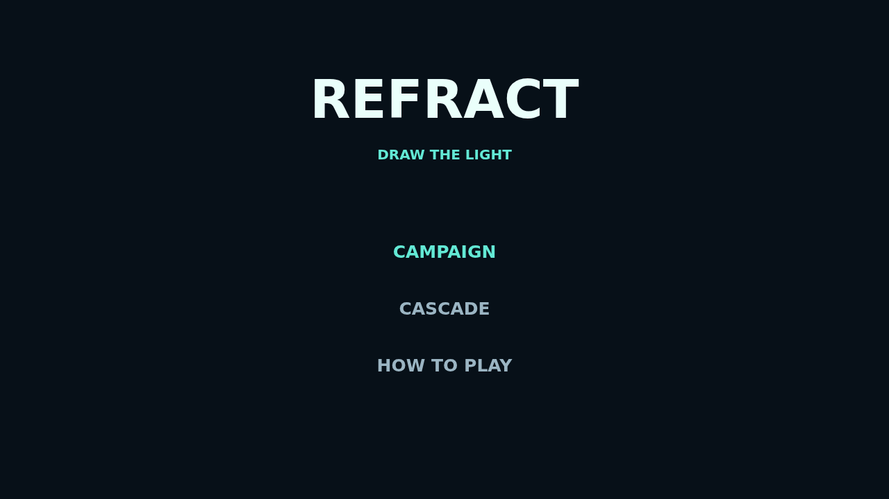

# Bend the light. Solve the bench.

Refract turns every puzzle into a glowing optical sketch. Press an outlined emitter and trace its beam from node to node, threading every filled lens before reaching the matching emitter.

Crystals belong to every color. Spend each of their charges exactly once while keeping beams from sharing edges or crossing on diagonals—the route that looks obvious is often only the beginning.

Follow the handcrafted 24-board Campaign from first principles to densely interlocked three-color puzzles, or enter Cascade for an endless climb through fresh arrangements.

